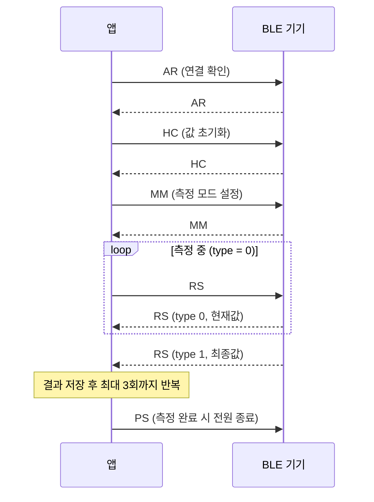

# 2026-Android-BLE

Kotlin과 Jetpack Compose로 만든 **Android BLE(Bluetooth Low Energy) 통신 앱**입니다.
주변 BLE 기기를 검색해 연결하고, 자체 프로토콜 명령을 주고받아 **악력(kg) 측정값을 실시간으로 화면에 표시**합니다.

---

## 목차
1. [주요 기능](#주요-기능)
2. [기술 스택](#기술-스택)
3. [화면 구성](#화면-구성)
4. [BLE 통신](#ble-통신)
5. [측정 시퀀스](#측정-시퀀스)
6. [권한](#권한)
7. [프로젝트 구조](#프로젝트-구조)

---

## 주요 기능

| 기능 | 설명 |
| --- | --- |
| BLE 스캔 | 주변 BLE 기기를 검색하고 기기 이름, MAC 주소, 신호 세기(RSSI)를 목록으로 표시 |
| 기기 연결 | 목록에서 선택한 기기에 GATT로 연결하고 알림(Notify)을 활성화 |
| 명령 송수신 | 체크섬이 포함된 자체 프레임으로 명령을 보내고, 응답을 검증해서 해석 |
| 악력 측정 | 측정 시작 → 실시간 값 표시 → 최대 3회 측정 결과 기록 |
| 상태바 | 블루투스 / Wi-Fi / 인터넷(셀룰러) / 배터리 / 현재 시간을 상단에 표시 |

## 기술 스택

- **언어**: Kotlin
- **UI**: Jetpack Compose, Material 3 (Adaptive Navigation Suite)
- **아키텍처**: ViewModel + StateFlow (단방향 데이터 흐름)
- **비동기**: Kotlin Coroutines / Flow
- **통신**: Android BLE API (`BluetoothGatt`, `BluetoothLeScanner`)
- **SDK**: minSdk 26 / targetSdk 36

## 화면 구성

앱은 하단(또는 측면) 내비게이션으로 두 화면을 오갑니다.

### 1. Scan & Connect
- 스캔 시작 시 권한을 확인하고 주변 기기를 검색합니다.
- 기기를 누르면 연결을 시도합니다.

### 2. 측정 화면
- 연결 상태와 마지막 응답 메시지를 표시합니다.
- 현재 측정값을 큰 글씨로 보여줍니다.
- 버튼 3개로 흐름을 제어합니다.
  - **측정 시작**: 1회차 측정 시작
  - **재측정**: 3회가 끝난 뒤 처음부터 다시 측정
  - **측정 완료**: 기기에 전원 종료 명령을 보내고 종료
- `측정 횟수: n / 3`과 회차별 결과(`1회: xx.x kg`)를 목록으로 표시합니다.

## BLE 통신

### GATT 서비스
Nordic UART Service(NUS)를 사용합니다.

| 항목 | UUID |
| --- | --- |
| Service | `6e400001-b5a3-f393-e0a9-e50e24dcca9e` |
| RX (앱 → 기기, Write) | `6e400002-b5a3-f393-e0a9-e50e24dcca9e` |
| TX (기기 → 앱, Notify) | `6e400003-b5a3-f393-e0a9-e50e24dcca9e` |
| CCCD | `00002902-0000-1000-8000-00805f9b34fb` |

### 프레임 구조

```
| STX | 0x68 | LEN_L | LEN_H | CMD (2byte) | DATA (n byte) | CRC | ETX |
| 0x02|      |       |       |  ASCII      |  선택         |     | 0x03|
```

- `LEN_L`, `LEN_H`: `CMD + DATA` 길이를 6비트씩 나눠 `+0x0A`한 값
- `CRC`: `0x68 + LEN_L + LEN_H + CMD + DATA`의 합에서 하위 6비트를 취하고 `+0x0A`한 값
- 수신한 프레임은 다시 인코딩해서 원본과 같은지 비교하는 방식으로 검증하고, 불일치하면 버립니다.

### 명령어

| CMD | 방향 | 설명 |
| --- | --- | --- |
| `AR` | 앱 ↔ 기기 | 연결 확인 |
| `HC` | 앱 ↔ 기기 | 측정값 초기화 |
| `MM` | 앱 ↔ 기기 | 측정 모드 설정 (DATA: `'0'`) |
| `RS` | 앱 ↔ 기기 | 측정 상태 및 측정값 요청 / 응답 |
| `DS` | 기기 → 앱 | 단위·부저 설정 응답 |
| `PS` | 앱 ↔ 기기 | 전원 종료 |

`RS` 응답의 첫 글자로 측정 상태를 구분합니다.

| 값 | 의미 |
| --- | --- |
| `0` | 측정 중 (값을 갱신하고 다시 `RS` 요청) |
| `1` | 측정 완료 (결과 저장 후 다음 회차 진행) |
| `2` | 측정 에러 (다음 회차 진행) |

측정값은 정수로 오며 10으로 나눠 소수 첫째 자리로 표시합니다. (예: `253` → `25.3 kg`)

## 측정 시퀀스



## 권한

| 권한 | 용도 |
| --- | --- |
| `BLUETOOTH_SCAN` | BLE 기기 검색 (Android 12 이상) |
| `BLUETOOTH_CONNECT` | BLE 기기 연결 (Android 12 이상) |
| `BLUETOOTH`, `BLUETOOTH_ADMIN` | Android 11 이하 BLE 사용 |
| `ACCESS_FINE_LOCATION`, `ACCESS_COARSE_LOCATION` | Wi-Fi 신호 세기 조회, Android 11 이하 BLE 스캔 |
| `READ_PHONE_STATE` | 셀룰러 신호 세기 조회 |
| `ACCESS_NETWORK_STATE`, `ACCESS_WIFI_STATE` | 네트워크 / Wi-Fi 상태 조회 |

## 프로젝트 구조

```
app/src/main/java/com/example/androidble/
├── MainActivity.kt
├── destination/        내비게이션 목적지 정의
├── data/
│   ├── ble/            BleScanner, BleConnection, BleUuids
│   │   └── protocol/   BleCommand(프레임), GripModule(응답 해석)
│   └── system/         블루투스 · Wi-Fi · 네트워크 · 배터리 · 시간 감지
├── ui/
│   ├── screens/        ScanScreen, HsgTestScreen, ScanViewModel
│   ├── components/     StatusBar, 각종 Indicator, ScannedDeviceItem
│   ├── models/         화면 상태 모델
│   └── theme/          색상, 타이포그래피, 테마
└── util/               권한 처리, 시간 유틸, 시스템 브로드캐스트 수신
```
